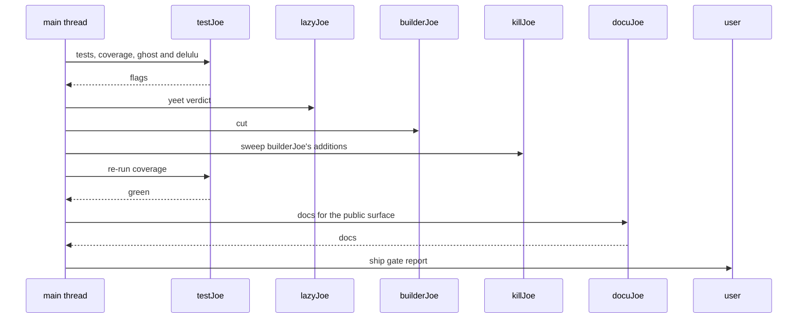

SuperJoe Ship = the second half of the crew. Run it after the user has reviewed the
`superjoe-code` patch. It adds tests and docs, then stops at the ship gate. It does not
run the architecture map.

Every joe carries the rules it needs. Read no file for them.

## The contract

A prompt is an envelope, nothing else:

| Field        | Carries                                           |
| ------------ | ------------------------------------------------- |
| `Work:`      | the reviewed branch, diff, file, or PR            |
| `Goal:`      | one user story, or `Steps:` for a QED repro       |
| `Phase:`     | `report` or `prove`                               |
| `Shard:`     | the chunk this worker owns: `1/2 src/money.py`    |
| `Ledger:`    | `.cache/joe/ship-ledger.md`, or `none`            |
| `Note:`      | `.cache/joe/deps/<subject>.md`, or `none`         |
| `Mode:`      | `lite`, `full`, `ultra` for builders and trimmers |
| `User said:` | the user's own words, verbatim                    |

Missing `Work:` or `User said:`: `ambiguous. ask: <one question>.` Never guess the work.

One line per finding, no preamble:

`<tag>: <lane> <what>. [<key>]`

The tag opens the line: no bullet, no number, no bold, no backtick. A decorated line is not
a finding line. Ratings ride the same line: `bet: N/10 cooked: N/10`. A `receipts:` block
opens under the `real:` line above it. A finding with no file keys on its subject:
`[deps:<pkg>]`, `[docs:<topic>]`.

| Lane    | Owner       | Tags                                  | Work                                |
| ------- | ----------- | ------------------------------------- | ----------------------------------- |
| `bloat` | lazyJoe     | `yeet` `duh` `NPC` `cringe` `glow up` | over-engineering and dead code      |
| `doc`   | docuJoe     | `yeet` `real`                         | docstrings, comments, README        |
| `test`  | testJoe     | `ghost` `delulu`                      | coverage, ghost and delulu branches |
| `deps`  | researchJoe | `kept` `dropped`                      | packages, APIs, upstream docs       |

`[path:L<line>]` is the key. Two lanes on one key: the highest lane wins,
`bloat` > `doc` > `test` > `deps`.

Never, from the main thread either: no `rm`, `git rm`, `-delete`, or truncation, since
removing a file is the user's call, asked for as `needs-confirm. op: <command>.` The one
exception is `killJoe`, which may delete a test file that `builderJoe` created. No test,
linter, or hook run outside `testJoe`. No write outside the work reference.

## Tests

NEVER run tests, a test runner, or the test suite from the main thread.
NEVER run linters or pre-commit hooks.
Route every test run to `testJoe`.
Ask for the smallest selection that covers the change.
The user shares this machine, and test runs eat CPU.

## The testing loop

1. `testJoe` writes tests, hits 100% coverage, flags ghost branches and delulu checks the signature already guarantees. It runs the hooks with `prek` and reports every finding back. An autofix still counts as a finding. It edits no production code.
1. `lazyJoe` tags each flag `yeet:`.
1. `builderJoe` cuts it.
1. `killJoe` sweeps the run. The tests, docstrings, and comments `builderJoe` added go. The tests `testJoe` wrote stay.
1. `testJoe` re-runs coverage once per round of cuts, not per cut.

Any production change reopens the review and harden gates in `superjoe-code` for the lanes
the cut touches. Ask the user before re-running that map.

## Docs

Run `docuJoe` after the testing loop is green. It documents the public surface and updates
the README. It edits no production code. `killJoe` never runs after `docuJoe`, so the docs
survive.

## Ship gate

Ship only when the testing loop is green and `docuJoe` has closed the docs.

- 100% coverage.
- Every flagged branch cut.
- Hooks pass.
- Docs match the code.

A failing gate sends the work back to its owner.

## Out-of-scope findings

Deferred, never fixed:

1. The reviewer emits one `side quest: <what>. <why>. [path:L<line>]` line.
1. The main thread writes one `deferred` row and files one `gh issue create`, quoting the line, the repo, and the work reference.
1. No other agent touches it, or any out-of-scope code it notices.

## Modes

Pass the user's `lite`, `full`, or `ultra` mode to `builderJoe` and `lazyJoe`. Default:
`full`.

## Agents

| Task                          | Agent         | Lane    |
| ----------------------------- | ------------- | ------- |
| tests, coverage, ghost/delulu | `testJoe`     | `test`  |
| concise goal-oriented docs    | `docuJoe`     | `doc`   |
| trim bloat / over-engineering | `lazyJoe`     | `bloat` |
| write minimal surgical code   | `builderJoe`  | fix     |
| strip builderJoe's extras     | `killJoe`     | `clean` |
| find, vet, and note packages  | `researchJoe` | `deps`  |
| orchestrate the loop          | main thread   | none    |

Rule: the main thread loops. Each agent does one step. Spawn `researchJoe` from any step
when a dependency or fact needs checking.

## Prompting agents

Prompt = the envelope, nothing else:

- `Work:` the reviewed branch, diff, file, or PR
- `Goal:` one user story sentence, or `Steps:` QED for a bug
- `Phase:` `report` for the first pass, `prove` to investigate a flag
- `Shard:` `1/2 src/money.py` for a sharded pass, omitted otherwise
- `Ledger:` `.cache/joe/ship-ledger.md`, or `none`
- `Note:` `.cache/joe/deps/<subject>.md` for `researchJoe`, `none` when read-only
- `Mode:` the user's mode, to `builderJoe` and `lazyJoe` in every prompt
- `User said:` the user's own words, verbatim

For `killJoe`, `Phase: report`, and `Work:` is the diff `builderJoe` just wrote.

## Flow

